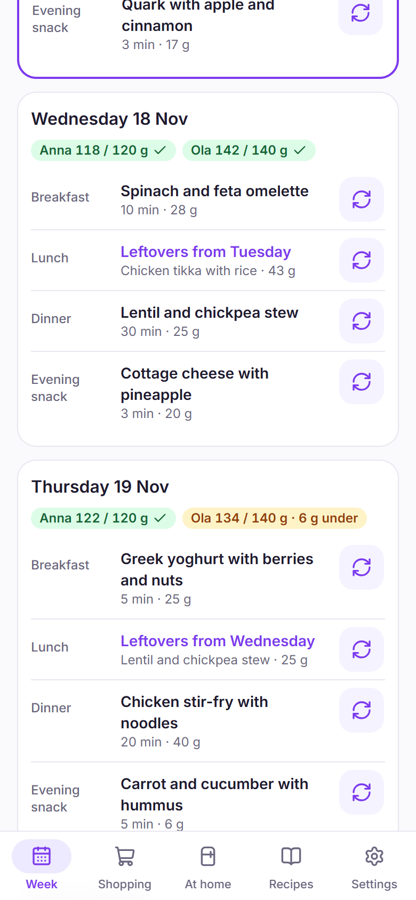
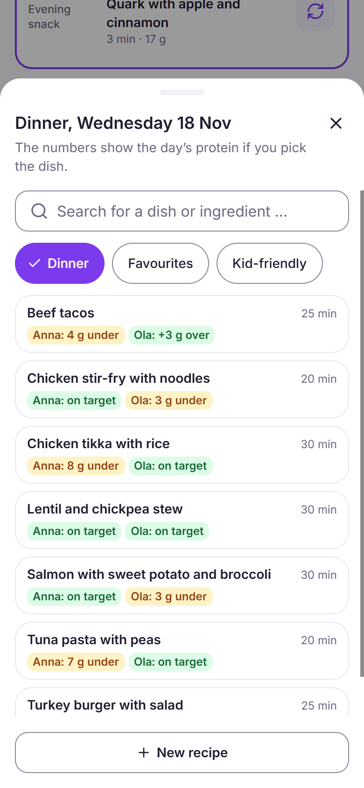
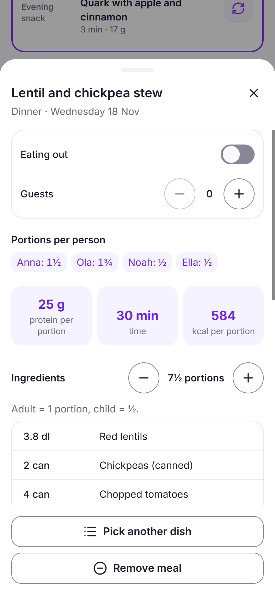
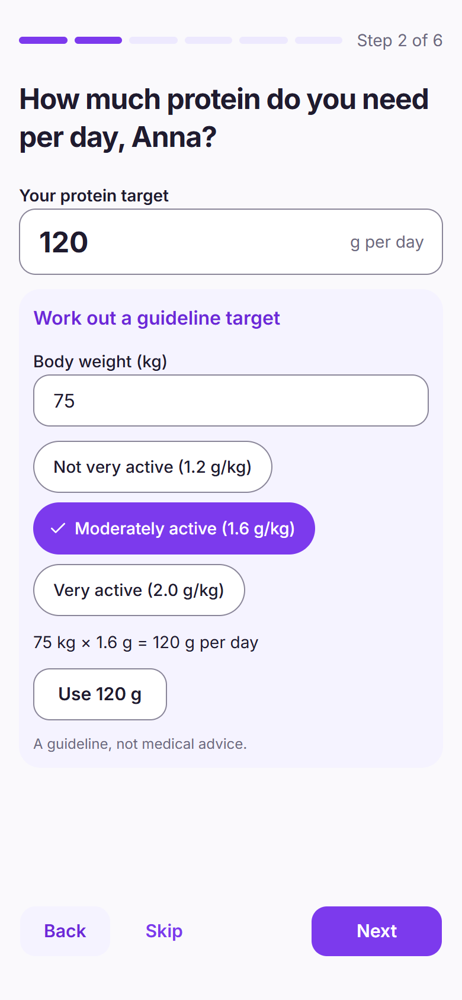
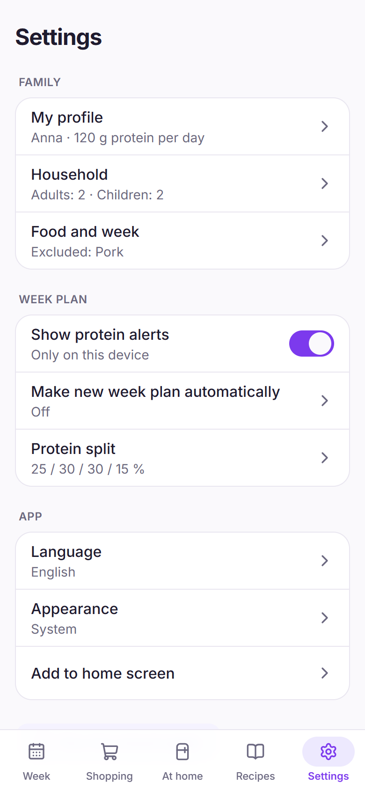

# Måltidsplanlegger

**A mobile-first meal planner for families, built around personal daily protein targets.**

Each adult sets their own protein target. The app plans breakfast, lunch, dinner and an evening snack for the week, scales every person's portion so the day adds up to their target, and keeps the week varied and child-friendly. It installs on any phone as a Progressive Web App (PWA).

**Live demo:** coming soon

> The app is Norwegian by default, with German and English built in. The screenshots below use the English interface.

<table>
  <tr>
    <td align="center"><br><sub>Week plan</sub></td>
    <td align="center"><br><sub>Pick a dish</sub></td>
    <td align="center"><br><sub>Meal details</sub></td>
    <td align="center"><br><sub>Onboarding</sub></td>
    <td align="center"><br><sub>Settings</sub></td>
  </tr>
</table>

## The problem

Families who care about protein end up doing arithmetic every evening: one adult needs 120 g a day, the other 140 g, the children just need normal food, and the plan has to fit a busy weekday. Ordinary meal planners plan *dishes*; they do not tell you whether each person actually reaches their target, or how much of the dish each person should eat.

## What it does (phase 1)

- **Personal protein targets.** Every adult has a daily target, split across the day (25 / 30 / 30 / 15 %, adjustable). Portions are scaled per person (0.75×–2×). Children get half a portion and no target.
- **A week plan in one tap.** Dinners take at most 30 minutes, never repeat within the week and never use the same protein source two days in a row. Favourites come up twice as often. Excluded food (pork by default) is never suggested, and children's dislikes are avoided where possible.
- **Leftovers for lunch.** Dinner is cooked with extra portions for the next day's lunch. If a dinner is not cooked at home, the next lunch becomes a quick lunch, and the leftovers come back when the dinner does.
- **Clear status per person and day.** Each day shows "Anna 118 / 120 g ✓" or "Ola 134 / 140 g · 6 g under". When a day is short, the app suggests an honest protein boost (e.g. skyr + milk) that can be added in one tap.
- **Plan it yourself.** Swap a dish (↻), pick one from a list that shows the effect on every adult's target before choosing, mark a meal as eating out, add guests, or remove a meal on a day with low appetite. Every change has its own undo (↶).
- **Onboarding and settings.** A six-step wizard (everything can be skipped) with a guideline protein calculator. Changing settings later updates the planned weeks from today, replacing only the dishes that no longer fit.
- **Built for everyone.** Light and dark mode, Norwegian / German / English, installable on Android and iPhone, works offline. WCAG 2.2 AA is a requirement (see [Accessibility](#accessibility)).

Data is stored on the device for now. Accounts and sharing within a household come in a later phase.

## Tech stack

| Area | Choice |
|---|---|
| App | React 19, TypeScript, Vite |
| UI | Tailwind CSS v4, shadcn/ui (Radix), vaul bottom sheets, sonner toasts, lucide icons, self-hosted Inter |
| Routing and text | React Router (each screen loaded on demand), react-i18next (nb, de, en), date-fns |
| PWA | vite-plugin-pwa (installable, offline, auto-updating) |
| Data | `localStorage` behind one repository module, so it can be swapped for Supabase later |
| Quality | Vitest (97 tests on the planning and protein rules), oxlint, a colour contrast check, Lighthouse |

The planner is a set of pure functions (`src/data/planner.ts`, `src/data/protein.ts`) with no UI code, which makes the business rules easy to test. The generator's rules are checked over 200 seeded random weeks.

## Getting started

Requires Node.js 20.19+ or 22.12+.

```bash
npm install
npm run dev          # http://localhost:5173
```

**On your phone:** connect the phone to the same Wi-Fi as your computer and run

```bash
npm run dev:phone
```

Vite prints a `Network:` address (e.g. `http://192.168.1.20:5173`). Open it in the phone's browser. Windows may ask whether Node.js may use the network – allow it for private networks.

Other scripts:

```bash
npm test             # unit tests (watch mode); `npx vitest run` runs them once
npm run build        # type check + production build in dist/
npm run preview      # serve the production build
npm run lint         # oxlint
npm run check:contrast   # check all colour pairs against WCAG AA
```

To see the app with data right away, tap **Try with an example family** on the first screen: two adults with protein targets and two children get a finished week plan.

## Accessibility

WCAG 2.2 AA is a project requirement, not an afterthought: contrast is checked for both themes, colour is never the only signal (status labels always have text), every icon button has a label, the app works fully with a keyboard, focus moves to the heading on each wizard step, changes are announced to screen readers, and reduced motion is respected. The Lighthouse audit of the app shell scored 100 for accessibility on mobile and desktop ([docs/LIGHTHOUSE.md](docs/LIGHTHOUSE.md)).

## Roadmap

| Phase | Content | Status |
|---|---|---|
| 1 | Foundation: design system, data model, recipes, planner, week plan, onboarding, settings | ✅ Done |
| – | Publish (live demo) | Next |
| 3 | Home + shopping list: approve the week plan, check what you have at home, confirmed shopping list | Planned |
| 2 | Cooking mode, ratings, mark meals as eaten, check-in and weekly summary | Planned |
| 4 | Voice commands | Planned |
| 5 | Login (Google, email, passkeys) and sharing within the household | Planned |
| 6 | AI: fridge suggestions, recipe import from a link or photo | Planned |
| 7 | Insights: reminders, feedback button, analytics | Planned |

Phase 3 was moved ahead of phase 2 after acceptance testing showed the shopping list is core value ([decision #144](docs/DECISIONS.md)).

## How this project was built

I am the product owner of this project. I set the vision, wrote the requirements, made every product and design decision, and ran acceptance tests after each milestone. The code was written with [Claude Code](https://claude.com/claude-code) as the developer, working in small milestones that stopped for my review.

The working process is documented in the repository:

- **[Decision log](docs/DECISIONS.md)** – every decision with date, alternatives, rationale and consequences (175+ entries).
- **[Feedback log](docs/FEEDBACK_LOG.md)** – what acceptance testing found and what changed because of it.
- **[Product requirements](docs/PRD.md)** – problem, users, goals and success metrics, prioritised features.
- **[Backlog](docs/BACKLOG.md)** – ideas deliberately postponed, with the reason.

## Project docs

- [`docs/PRD.md`](docs/PRD.md) – product requirements (English)
- [`docs/DECISIONS.md`](docs/DECISIONS.md) – decision log
- [`docs/FEEDBACK_LOG.md`](docs/FEEDBACK_LOG.md) – user feedback and what changed
- [`docs/BACKLOG.md`](docs/BACKLOG.md) – postponed ideas
- [`docs/LIGHTHOUSE.md`](docs/LIGHTHOUSE.md) – Lighthouse audits
- [`docs/README.md`](docs/README.md) – overview of all docs, including the original Norwegian brief

## License

© 2026 Yalda Akhgar. All rights reserved. The code is public so it can be read and reviewed; it may not be copied, modified or redistributed without permission.
